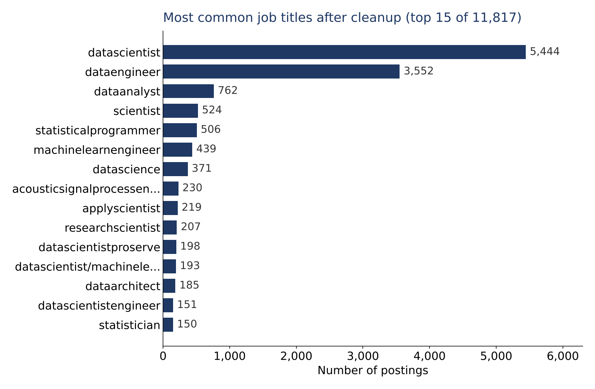
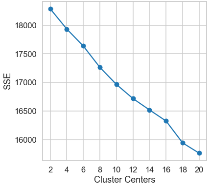
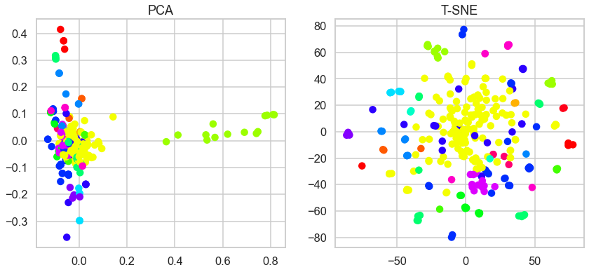

# Hacking the Data Science Job Description

My final project (Project 5) at the Metis Data Science Bootcamp, March 2021. I scraped data job postings from Indeed.com and used natural language processing to see which skills each job title asks for and how the titles differ.

## Files

- `Project 5 Cline.ipynb`: the original 2021 notebook.
- `Project 5 Presentation.pdf` (and `.pptx`): slides remade in October 2026, using only the results in the notebook.
- `charts/`: the title counts, and the elbow and PCA/t-SNE plots from the notebook.

## Data

39,209 postings from seven scraped files, each with the job title and the full posting text. I lowercased the titles, removed punctuation and filler words (senior, lead, remote, state names and so on) and joined what was left into one label, so "Senior Data Scientist, Remote" became "datascientist". That left 11,817 different titles. I kept the 150 most common as labels, and 19,691 postings had one of them.

The descriptions got the same cleanup. I also removed the title words from them (data, scientist, engineer and the 150 labels) so the model couldn't read the title back out of the text.

## Predicting the title

LinearSVC, one-vs-rest over the 150 titles, on TF-IDF scores of the descriptions. A grid search over C (1, 10, 100 and 1,000) with 30-fold cross-validation picked C = 100. On the 3,939 test postings:

| Measure | Result |
|---|---:|
| Jaccard score (out of 100) | 88.3 |
| Hamming loss | 0.12% |
| Precision | 92.9% |
| Recall | 88.9% |

Precision and recall were worked out in 2026 from the per-title confusion matrices in the notebook.

The overall score is probably too high. 94 of the 150 titles were predicted perfectly, and many of those are one employer posting the same job many times, like an acoustic signal processing title with 230 postings. The descriptions still had company names in them, so copies of the same posting in the training and test sets were easy to match. The common titles are a fairer test: data scientist 93% recall, data engineer 91%, data analyst 72% and machine learning engineer 66%.

I started a comparison of 12 models, as in Project 3, but stopped it before it finished, so there is no baseline to compare against.

## Topics and clusters

An NMF topic model and MiniBatchKMeans, both with 18 groups, on the 19,691 descriptions. Several topics and clusters were single employers (Amazon, Intuit, Facebook). Others were fields such as drug studies, university research and agriculture. The k-means error kept falling as clusters were added, with no clear elbow, and most postings sit in one large group in the PCA and t-SNE plots.

## What I would change

- Remove duplicate postings before splitting the data.
- Strip company names, locations and benefits text from the descriptions.
- Group the titles into a few job families before modeling.
- Finish the model comparison, with a dummy baseline.
- Rerun the notebook from top to bottom. It was run in several sessions, so some printed outputs (such as the 39,209-row shapes after the title filter) come from earlier runs than the final model.

## AI use

The 2021 notebook and its results are my own work. In October 2026 I rewrote this README and remade the slides with AI help, using only the results in the notebook. I also redrew the title chart from the notebook's counts; the elbow and PCA/t-SNE charts are the notebook's own.

Garreth Cline
